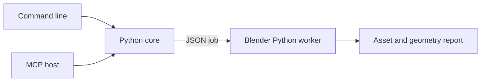

# Blender-Agent Refinement Toolkit · Code Stack

**Programming language architecture for Blender automation**

[Stack](STACK.md) · [Memory](STACK_MEMORY.md) · [Audit](AUDIT.md) · [Proposals](PROPOSALS.md) · [Release registry](code-stack.json)

> [!TIP]
> **Starting with a new agent?** Give it this README URL and say **“Read Code Stack and work as Stack.”** It can load the [role](STACK.md) and [recorded project context](STACK_MEMORY.md) directly from Git.

## Where each language belongs

| Layer | Choice | Why it belongs |
| --- | --- | --- |
| **Core and host tooling** | Python | The CLI and MCP adapter share asset and job logic. The core declares no runtime dependencies, and MCP is optional. [Architecture](https://github.com/vixttha/Blender-Agent-Refinement-Toolkit/blob/25788c01234841693ce0605053798a39cda7ba9a/docs/ARCHITECTURE.md) · [Package](https://github.com/vixttha/Blender-Agent-Refinement-Toolkit/blob/25788c01234841693ce0605053798a39cda7ba9a/pyproject.toml) |
| **Inside Blender** | Python with `bpy` and `bmesh` | These Blender APIs are already used by the worker for scene and mesh operations. [Worker](https://github.com/vixttha/Blender-Agent-Refinement-Toolkit/blob/25788c01234841693ce0605053798a39cda7ba9a/src/blender_agent/blender_worker.py) · [Blender API](https://docs.blender.org/api/main/info_overview.html) |
| **Between processes** | JSON | The host writes explicit job data and the worker returns a geometry report. [Host](https://github.com/vixttha/Blender-Agent-Refinement-Toolkit/blob/25788c01234841693ce0605053798a39cda7ba9a/src/blender_agent/jobs.py) · [Worker](https://github.com/vixttha/Blender-Agent-Refinement-Toolkit/blob/25788c01234841693ce0605053798a39cda7ba9a/src/blender_agent/blender_worker.py) |
| **Build, checks and documentation** | TOML, YAML, embedded Bash and Markdown | Package configuration, free public-runner CI and human-readable project documentation. [Workflow](https://github.com/vixttha/Blender-Agent-Refinement-Toolkit/blob/25788c01234841693ce0605053798a39cda7ba9a/.github/workflows/ci.yml) · [GitHub runner billing](https://docs.github.com/en/actions/concepts/billing-and-usage) |

## Where the stack can grow

| If we approve this work | Consider | Design review |
| --- | --- | --- |
| Browser asset preview | TypeScript with HTML/CSS | [CS-002](PROPOSALS.md#cs-002--browser-asset-viewer) |
| A demonstrated mesh-processing bottleneck | Rust for an isolated helper, or C++ for a specific geometry library | [CS-003](PROPOSALS.md#cs-003--measure-before-native-code) |
| Artist-editable parametric models | Python with Blender Geometry Nodes | [CS-004](PROPOSALS.md#cs-004--editable-procedural-modeling) |

## Evidence you can follow

| Record | What it tells you |
| --- | --- |
| [Language review](AUDIT.md) | Current application review, published baseline, and evidence limits |
| [Release technology registry](code-stack.json) | Recorded roles and primary evidence for the published application |
| [Code Stack Actions](https://github.com/vixttha/Blender-Agent-Refinement-Toolkit/actions/workflows/code-stack.yml) | Latest language report in the job summary and downloadable current and release review packages |
| [Portable template v0.0.3](https://github.com/vixttha/Blender-Agent-Refinement-Toolkit/tree/8dd56cdd53897b5a78f3a59d9ca2549f1c08f885/v0.0.3) | One-run inventory, language recommendations, and exact-commit evidence. [Hub settings](language-review.json). |

Documentation patterns we borrowed

- **VS Code** documents source organization by architectural layer. This hub maps technologies to Blender-Agent Refinement Toolkit's execution boundaries. [VS Code source organization](https://github.com/microsoft/vscode/wiki/Source-Code-Organization)
- **Rust RFCs** put motivation, trade-offs and alternatives alongside each proposal. Our proposals add validation and rollback for the specific project. [Rust RFC template](https://github.com/rust-lang/rfcs/blob/master/0000-template.md)
- **CPython** uses its README to route users to documentation and practical next steps. The links above give humans and agents a short path to the files they need. [CPython README](https://github.com/python/cpython/blob/main/README.rst)

**Audited release:** [Blender-Agent v0.0.2 pre-release](https://github.com/vixttha/Blender-Agent-Refinement-Toolkit/releases/tag/v0.0.2) · [Source commit cb945bd](https://github.com/vixttha/Blender-Agent-Refinement-Toolkit/commit/cb945bd8531ee425615c1968612ab6503849369d)

The hub reviews the current application branch on every hub pull request and push. Each run generates a release baseline and a current report with tradeoffs, source links, and decisions to revisit. See the [audit](AUDIT.md) for refresh instructions and runtime evidence.
